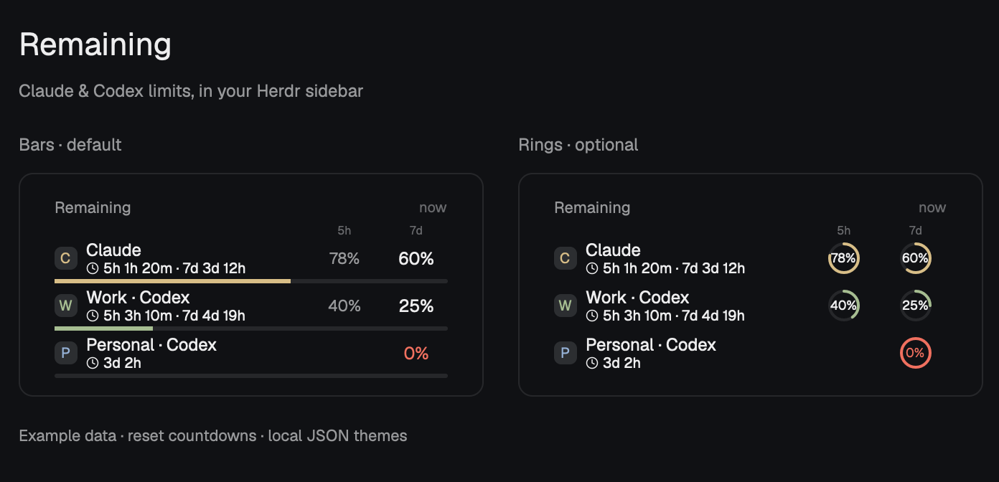

# Remaining

Remaining shows Claude and Codex subscription limits in a native [Herdr](https://herdr.dev) sidebar.
It reuses existing CLI logins.



Bars is the default style. It shows remaining percentages and one weekly bar.
Rings shows the same values in small dials.
Both styles keep the same account positions and reset countdowns.

## Install

The requirements are Herdr, Node.js 18 or newer, and existing Claude Code or Codex subscription logins.
The Codex CLI must support `--no-daemon app-server` and account RPCs.
We tested the mod on macOS. Linux credential paths exist, but we did not test them with live accounts.
The shell launcher does not support Windows.
These steps use the default Herdr home, `~/.config/herdr-app`.

1. Read `~/.config/herdr-app/AGENTS.md`.
2. Download the source:

   ```sh
   git clone https://github.com/iyk2h/herdr-remaining.git
   ```

3. Open the project folder:

   ```sh
   cd herdr-remaining
   ```

4. Build the package:

   ```sh
   npm run build:release
   ```

5. Install the package from the reported folder:

   ```sh
   node tools/releases.mjs install --release "/absolute/path/to/dist/<release-id>"
   ```

6. If you use a shipped layout, clone that layout before the next step.
7. Add this block to your personal sidebar:

   ```json
   {
     "id": "remaining",
     "type": "block",
     "size": { "px": 132 },
     "min": 112,
     "content": { "mod": "remaining" }
   }
   ```

8. Do the native check:

   ```sh
   herdr-app check ~/.config/herdr-app/mods/remaining
   ```

9. Examine the sidebar in Herdr.

The installer leaves your layout intact.
Legacy installations require [adoption](docs/maintenance.md#existing-installations).
Managed installations use the [update procedure](docs/maintenance.md#update).
If another mod uses the name `remaining`, keep that mod.
Ask your assistant to adapt the installation paths.

## Controls

| Control | Action |
| --- | --- |
| Refresh | Reads current limits. The default automatic interval is 5 minutes. |
| Settings | Changes account pauses, account order, style, and refresh interval. |
| Copy diagnostics | Copies a report without account identities or limit values. |
| Copy settings / Restore settings | Transfers Remaining settings through the clipboard. |
| Right-click an account | Opens the official usage page. The browser can use a different login. |
| Hover over an account | Shows exact reset times, account identity, and query details. |

Optional keybinding actions are `remaining.refresh`, `remaining.settings`, `remaining.bars`, and `remaining.rings`.
The mod adds no default keybindings or limit notifications.

## Limits and privacy

If a monitored account reports a window, the matching `5h` or `7d` column appears.
A missing value does not mean zero or unlimited usage.

The mod stores account identities and limits in a local cache.
It adds no telemetry and starts no model conversation.
[Account access](mods/remaining/ACCOUNTS.md#provider-access) describes credential use and network requests.
The preview uses example accounts only.

## Documentation

| Guide | Purpose |
| --- | --- |
| [Account settings](mods/remaining/ACCOUNTS.md) | Login discovery, overrides, provider access, and local data. |
| [AI commands](mods/remaining/AI.md) | Diagnostics, account recommendations, and settings backups. |
| [Themes](mods/remaining/THEMES.md) | JSON themes, display rules, and data rules. |
| [Maintenance](docs/maintenance.md) | Development, updates, rollback, and recovery. |
| [Recipe](RECIPE.md) | Herdr components and acceptance criteria. |
| [Changelog](CHANGELOG.md) | Version changes. |

The project uses the [MIT license](LICENSE).
Lucide icons include their [license notice](mods/remaining/icons/LICENSE.txt).
