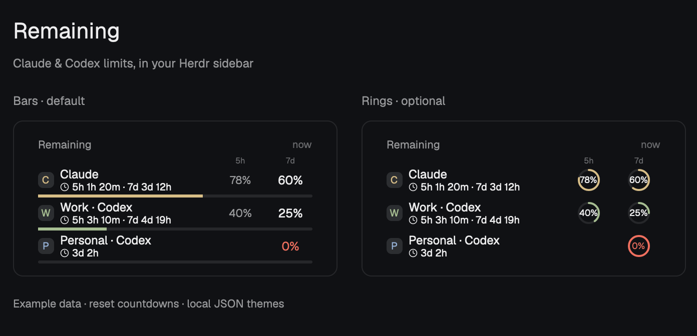

# Remaining

A small native panel for available Claude and Codex subscription capacity.

The [README](README.md) contains the overview, preview, and installation procedure.

## What you see

Each account has a badge, remaining percentages, and a reset clock.
Bars uses a weekly track. Rings uses dials without moving account rows.
[Themes](mods/remaining/THEMES.md) defines the exact geometry and conditional columns.

## How it behaves

The panel reuses local CLI accounts and updates on the selected schedule.
Monitoring, order, and style live in Settings.
The [AI guide](mods/remaining/AI.md) describes the optional reports and settings transfers.

## Built from

The native view uses `gpui-kit` elements and `gpui-base` controls.
The mod declares `place: none` and uses one sidebar block.
The same view handles `settings` and `accountMenu` popup props.
Herdr supplies theme colors, shared state, commands, overlays, timers, and folder watchers.
Separate Node modules handle provider access and local data.
JSON files define themes through a bounded schema.

## Watch out

[Account settings](mods/remaining/ACCOUNTS.md) describes credentials and private local files.
Missing provider data stays unknown.
The AI guide defines account eligibility and unreported model capacity.

## Done when

1. Do the Node tests and native checks from the [maintenance guide](docs/maintenance.md).
2. Examine both styles with single-window and mixed-window example accounts.
3. Examine narrow widths, reset states, refresh errors, and settings actions.
4. Make sure that identity changes clear saved account values.
5. Make sure that invalid clipboard data leaves settings unchanged.
6. Make sure that failed updates preserve user files.
7. Examine the repository preview for real account information before publication.
